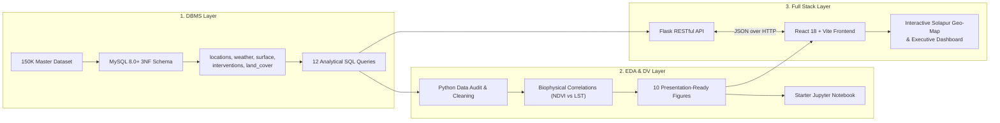

# HeatShield: Urban Heat Exposure Analysis and Cooling Intelligence Platform

**Integrated Semester Project** — B.Tech Semester III  
**Institution**: MIT Vishwaprayag University (MIT-VPU), Solapur, Maharashtra, India  
**Integrated Academic Tracks**:
1. Full Stack Development (FSD-1)
2. Database Management Systems (DBMS)
3. Exploratory Data Analysis & Data Visualization (EDA & DV)

---

## Team Details (`TF-141`)

| Member Name | Student PRN | Primary Project Role & Workstream Lead |
|---|---|---|
| **Furqan Bagwan** | `SCFU425004` | Lead Frontend Engineer & UI/UX Designer (FSD-1 Track) |
| **Aman Shaikh** | `SCFU425013` | Lead Data Analyst & Statistical Modeler (EDA & DV Track) |
| **Bhavin Shankur** | `SCFU425014` | Project Coordinator, Database Architect & Backend Lead (DBMS Track) |

---

## 1. Project Overview & Motivation

Rapid urban expansion, impermeable construction materials, and the loss of vegetative shade have created severe **Urban Heat Island (UHI)** microclimates in semi-arid Indian cities. **Solapur, Maharashtra** regularly experiences intense pre-monsoon summer conditions exceeding 42°C–44°C ambient air temperatures and 55°C land surface temperatures, posing severe heat stroke hazards to outdoor laborers, commuters, and high-density residential populations.

**HeatShield** is an integrated data engineering and intelligence web platform designed to:
- Monitor and model surface heat absorption across 9 urban morphological zones in Solapur.
- Detect localized **shade gaps** by synthesizing canopy cover fractions with pedestrian footfall density.
- Compute an objective, multi-criteria **Cooling Priority Score (0–100)**.
- Recommend targeted, cost-effective urban cooling interventions (e.g., Cool Roofs, High-Albedo Pavements, Miyawaki Urban Forests, Tensile Shade Canopies) with modeled cooling benefits (°C).

---

## 2. Three-Course Integrated Architecture

---

## 3. Phase 1 Deliverables Index

All official Phase 1 deliverables are documented in [`docs/PHASE_1/`](file:///F:/MIT%20VishwaPrayag%20University/3%20-%20Semester/FSD%20-%20DBMS%20-%20EDADV%20Combined%20Project/docs/PHASE_1/):

- **Proposal**: [`01_PROJECT_PROPOSAL.md`](file:///F:/MIT%20VishwaPrayag%20University/3%20-%20Semester/FSD%20-%20DBMS%20-%20EDADV%20Combined%20Project/docs/PHASE_1/01_PROJECT_PROPOSAL.md) — Academic proposal, problem statement, objectives, and scope.
- **Dataset Audit**: [`02_DATASET_DOCUMENTATION.md`](file:///F:/MIT%20VishwaPrayag%20University/3%20-%20Semester/FSD%20-%20DBMS%20-%20EDADV%20Combined%20Project/docs/PHASE_1/02_DATASET_DOCUMENTATION.md) — 57-column data dictionary, quality audit, and feasibility matrix.
- **Database Design**: [`03_DATABASE_DESIGN.md`](file:///F:/MIT%20VishwaPrayag%20University/3%20-%20Semester/FSD%20-%20DBMS%20-%20EDADV%20Combined%20Project/docs/PHASE_1/03_DATABASE_DESIGN.md) — 3NF relational normalization proofs, constraints, and indexes.
- **SQL Query Plan**: [`04_SQL_QUERY_PLAN.md`](file:///F:/MIT%20VishwaPrayag%20University/3%20-%20Semester/FSD%20-%20DBMS%20-%20EDADV%20Combined%20Project/docs/PHASE_1/04_SQL_QUERY_PLAN.md) — 12 relational queries covering joins, aggregations, and window functions.
- **EDA & DV Plan**: [`05_EDA_PLAN.md`](file:///F:/MIT%20VishwaPrayag%20University/3%20-%20Semester/FSD%20-%20DBMS%20-%20EDADV%20Combined%20Project/docs/PHASE_1/05_EDA_PLAN.md) — Statistical methodologies, correlation hypotheses, and 10 figure specs.
- **Wireframes**: [`06_APPLICATION_WIREFRAMES.md`](file:///F:/MIT%20VishwaPrayag%20University/3%20-%20Semester/FSD%20-%20DBMS%20-%20EDADV%20Combined%20Project/docs/PHASE_1/06_APPLICATION_WIREFRAMES.md) — 7 screen UI mockups and planned REST API routes.
- **Architecture**: [`07_TECHNOLOGY_AND_ARCHITECTURE.md`](file:///F:/MIT%20VishwaPrayag%20University/3%20-%20Semester/FSD%20-%20DBMS%20-%20EDADV%20Combined%20Project/docs/PHASE_1/07_TECHNOLOGY_AND_ARCHITECTURE.md) — 3-tier tech stack and offline presentation strategy.
- **Team & Git**: [`08_TEAM_AND_GITHUB_WORKFLOW.md`](file:///F:/MIT%20VishwaPrayag%20University/3%20-%20Semester/FSD%20-%20DBMS%20-%20EDADV%20Combined%20Project/docs/PHASE_1/08_TEAM_AND_GITHUB_WORKFLOW.md) — Team roles, commit standards, and branch hygiene.
- **ER Diagram**: [`ER_DIAGRAM.mmd`](file:///F:/MIT%20VishwaPrayag%20University/3%20-%20Semester/FSD%20-%20DBMS%20-%20EDADV%20Combined%20Project/docs/PHASE_1/ER_DIAGRAM.mmd) — Mermaid entity-relationship diagram.
- **Architecture Diagram**: [`ARCHITECTURE_DIAGRAM.mmd`](file:///F:/MIT%20VishwaPrayag%20University/3%20-%20Semester/FSD%20-%20DBMS%20-%20EDADV%20Combined%20Project/docs/PHASE_1/ARCHITECTURE_DIAGRAM.mmd) — Mermaid system architecture diagram.
- **Checklist**: [`PHASE_1_CHECKLIST.md`](file:///F:/MIT%20VishwaPrayag%20University/3%20-%20Semester/FSD%20-%20DBMS%20-%20EDADV%20Combined%20Project/docs/PHASE_1/PHASE_1_CHECKLIST.md) — Comprehensive MIT-VPU policy verification rubric.

---

## 4. Key Technical Artifacts

- **Production MySQL DDL**: [`backend/database/schema.sql`](file:///F:/MIT%20VishwaPrayag%20University/3%20-%20Semester/FSD%20-%20DBMS%20-%20EDADV%20Combined%20Project/backend/database/schema.sql)
- **Fictional Test Seed**: [`backend/database/seed.sql`](file:///F:/MIT%20VishwaPrayag%20University/3%20-%20Semester/FSD%20-%20DBMS%20-%20EDADV%20Combined%20Project/backend/database/seed.sql)
- **Starter EDA Notebook**: [`notebooks/01_heatshield_eda.ipynb`](file:///F:/MIT%20VishwaPrayag%20University/3%20-%20Semester/FSD%20-%20DBMS%20-%20EDADV%20Combined%20Project/notebooks/01_heatshield_eda.ipynb)
- **Dataset Inventory**: [`data/metadata/dataset_inventory.csv`](file:///F:/MIT%20VishwaPrayag%20University/3%20-%20Semester/FSD%20-%20DBMS%20-%20EDADV%20Combined%20Project/data/metadata/dataset_inventory.csv)
- **Primary Source Data**: [`Heat Shield Datasets & Charts/Heat Shield Master Dataset.csv`](file:///F:/MIT%20VishwaPrayag%20University/3%20-%20Semester/FSD%20-%20DBMS%20-%20EDADV%20Combined%20Project/Heat%20Shield%20Datasets%20&%20Charts/Heat%20Shield%20Master%20Dataset.csv)
- **Analytical Figures**: [`Heat Shield Datasets & Charts/charts/`](file:///F:/MIT%20VishwaPrayag%20University/3%20-%20Semester/FSD%20-%20DBMS%20-%20EDADV%20Combined%20Project/Heat%20Shield%20Datasets%20&%20Charts/charts/)

---

## 5. Technology Stack Summary

- **Frontend**: React 18, Vite, JavaScript, Tailwind CSS, Recharts, Leaflet.js
- **Backend**: Python 3.10+, Flask RESTful API, `mysql-connector-python`
- **Database**: MySQL 8.0+ (InnoDB)
- **Data Science**: Python, Pandas, NumPy, Matplotlib, Seaborn, Jupyter Notebook
- **Version Control**: Git & GitHub

---

## 6. Academic Provenance & Disclaimer

> [!NOTE]
> **Academic Simulation Statement**: The HeatShield dataset is a synthetic simulation computationally modeled on Solapur's actual geographical coordinates ($17.61^\circ\text{N} - 17.72^\circ\text{N}$, $75.84^\circ\text{E} - 75.96^\circ\text{E}$) and elevation profile (~458m). Every record is explicitly marked `is_synthetic = TRUE` and `data_source_type = 'Synthetic simulation'` in compliance with MIT-VPU academic honesty regulations.
